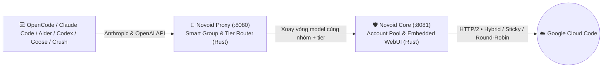

<div align="center">

# ⚡ Novoid Proxy

**Hệ thống AI Proxy 2 tầng hiệu năng cao viết hoàn toàn bằng Rust — tự động gom nhóm model, chọn tier thông minh (`novoid-*`) và xoay vòng đa tài khoản Google cho mọi AI Coding CLI.**

[](https://www.rust-lang.org/)
[](https://github.com/tokio-rs/axum)
[](https://www.docker.com/)
[](https://railway.app/)
[](LICENSE)

</div>

---

## 🏗️ Kiến trúc hoạt động



* **Tầng 1 — Novoid Proxy (`src/` — cổng `8080`):**
  * Viết hoàn toàn bằng **Rust (`Axum` + `Reqwest HTTP/2` + `Tokio`)**, tiêu thụ RAM cực thấp, streaming SSE zero-copy và ngắt kết nối tức thì khi client hủy hoặc shutdown.
  * Tự động gom toàn bộ model upstream thành **7 nhóm cố định (`novoid-*`)** dưới provider **`novoid-core`**, đồng thời công bố đầy đủ các **tier riêng cho từng nhóm** qua `GET /v1/models`.
  * Hỗ trợ song song cả **Anthropic Messages API (`/v1/messages`, `/v1/messages/count_tokens`)** và **OpenAI Chat Completions API (`/v1/chat/completions`)** (bao gồm `tools`, `tool_calls`, `role: "tool"`, `image_url`, streaming SSE & `reasoning_effort`).
  * Định tuyến thông minh theo tier yêu cầu (qua header `x-novoid-tier`, tên `<nhom>-<tier>` / `<nhom>#<tier>`, `output_config.effort`, `reasoning_effort` hoặc `thinking.budget_tokens`), tự xoay vòng model khác **cùng nhóm** khi gặp `429` / `400 RESOURCE_EXHAUSTED` / `404` / `5xx`, và ngắt ngay với lỗi pool `503`/`401`/`403` để tránh retry vô ích.
* **Tầng 2 — Novoid Core ([`hanovoid/novoid-core`](https://github.com/hanovoid/novoid-core) — cổng `8081`):**
  * Được clone và biên dịch native bằng Rust ngay trong multi-stage `Dockerfile`.
  * Quản lý đa tài khoản Google tại `~/.config/novoid-core/accounts.json`, tự động làm mới OAuth token, cân bằng tải (`hybrid` / `sticky` / `round-robin`), và phục vụ **Novoid Core WebUI** trực tiếp qua passthrough tại cổng `8080`.

---

## 📂 Cấu trúc Repository

```text
novoid-proxy/
├── Cargo.toml                  # Rust crate manifest & release profile (LTO thin)
├── Dockerfile                  # Multi-stage Rust build: hanovoid/novoid-core + novoid-proxy
├── start.sh                    # Khởi chạy Novoid Core (:8081) và Novoid Proxy (:8080)
├── src/
│   ├── main.rs                 # Entrypoint CLI (clap), warm-up model pool & graceful shutdown
│   ├── lib.rs                  # Export các module dùng chung
│   ├── router.rs               # Phân nhóm model, tier routing, failure classifier & group rotation
│   ├── server.rs               # Axum HTTP server (/v1/models, /v1/messages, /v1/chat/completions, passthrough)
│   └── openai.rs               # Chuyển đổi hai chiều OpenAI Chat Completions <-> Anthropic Messages & SSE
├── tests/
│   └── router_tests.rs         # Unit & E2E integration tests cho router, tiers & OpenAI adapter
├── configs/                    # File cấu hình mẫu cho 6 AI Coding CLI
│   ├── opencode/opencode.json
│   ├── claude-code/settings.json
│   ├── aider/.aider.conf.yml
│   ├── goose/config.yaml
│   ├── codex-cli/config.toml
│   └── crush/crush.json
├── scripts/                    # Script cài cấu hình tự động 1 lệnh
│   ├── install-clis.sh         # Linux / macOS
│   └── install-clis.ps1        # Windows PowerShell
└── docs/
    └── CLI-GUIDES.md           # Hướng dẫn chi tiết theo từng công cụ CLI & IDE extension
```

---

## 🎯 7 Nhóm Model & Tier hỗ trợ (Provider: `novoid-core`)

| Nhóm Model (ID) | Tên hiển thị | Các Tier hỗ trợ | Model upstream tương ứng |
| :--- | :--- | :--- | :--- |
| `novoid-default` *(Mặc định)* | **Novoid Default** | `default`, `low`, `medium`, `high` | `gemini-3-flash`, `gemini-2.5-flash` (tự căn `thinking.budget_tokens` theo tier) |
| `novoid-claude` | **Novoid Claude** | `default`, `opus-high`, `opus-medium`, `opus-low`, `sonnet-high`, `sonnet-medium`, `sonnet-low` | `claude-opus-*`, `claude-sonnet-*` theo sub-family & tier |
| `novoid-flash` | **Novoid Flash** | `default`, `high`, `medium`, `low`, `tiered`, `thinking`, `lite` | `gemini-3.8-flash-*`, `gemini-2.5-flash-thinking`, `gemini-3.5-flash-lite`, ... |
| `novoid-neon` | **Novoid Neon** | `default`, `xhigh`, `high`, `medium`, `low` | `gemini-4-neon-{xhigh\|high\|medium\|low}` |
| `novoid-hydrogen` | **Novoid Hydrogen** | `default`, `xhigh`, `high`, `medium`, `low`, `tiered-xhigh`, `tiered-high`, `sonar` | `gemini-4-hydrogen-*` |
| `novoid-carbon` | **Novoid Carbon** | `default`, `high`, `medium`, `low` | `gemini-4-carbon-{high\|medium\|low}` |
| `novoid-argon` | **Novoid Argon** | `default`, `high`, `medium`, `low` | `gemini-4-argon-{high\|medium\|low}` |

> **Tương thích mọi Harness:**
> * **OpenCode (V2):** Chọn tier trực tiếp qua `variants` (`x-novoid-tier` header).
> * **Claude Code / Aider / Goose / Crush / Cline / Roo Code:** Dùng trực tiếp model ID dạng `<nhom>-<tier>` (vd `novoid-hydrogen-xhigh`, `novoid-claude-opus-high`, `novoid-hydrogen-sonar`) hoặc Effort / Thinking budget.
> * **OpenAI Codex CLI:** Hỗ trợ cả `model_reasoning_effort` (`low` / `medium` / `high` / `xhigh`) lẫn `<nhom>-<tier>`.

---

## 🚀 Triển khai trên Railway (Docker)

1. **Deploy:** Tạo project trên Railway từ repo **`hanovoid/novoid-proxy`** → vào **Settings → Networking → Generate Domain** (cổng `8080`).
2. **Gắn Volume:** Thêm **Volume** vào service với Mount Path `/root/.config/novoid-core` để lưu bền vững `accounts.json` và cấu hình của **Novoid Core**.
3. **Nạp tài khoản Google:** Mở domain Railway trên trình duyệt → giao diện **Novoid Core WebUI** sẽ hiển thị ngay → bấm **Connect Google Account** hoặc **Import** file `accounts.json`.

---

## 🛠️ Chạy Local từ mã nguồn Rust

1. **Cài & chạy `novoid-core` (cổng `8081`):**
   ```bash
   git clone https://github.com/hanovoid/novoid-core.git
   cd novoid-core
   cargo install --path .
   ```
2. **Build & chạy `novoid-proxy` (cổng `8080`):**
   ```bash
   git clone https://github.com/hanovoid/novoid-proxy.git
   cd novoid-proxy
   cargo build --release
   ./start.sh
   ```
   Hoặc chạy riêng router trỏ tới một instance `novoid-core` có sẵn:
   ```bash
   cargo run --release -- --port 8080 --upstream http://127.0.0.1:8081
   ```
3. **Chạy bộ kiểm thử (Unit + E2E):**
   ```bash
   cargo test
   ```

---

## ⚙️ Biến môi trường chính

| Biến | Mặc định | Mô tả |
| :--- | :--- | :--- |
| `PORT` / `HOST` | `8080` / `0.0.0.0` | Cổng và địa chỉ bind của `novoid-proxy` |
| `UPSTREAM_URL` | `http://127.0.0.1:8081` | Địa chỉ kết nối tới `novoid-core` |
| `NOVOID_CORE_PORT` | `8081` | Cổng nội bộ của `novoid-core` khi chạy qua `start.sh` |
| `NOVOID_CORE_FALLBACK` | `false` | Đặt `true` để bật `--fallback` trên `novoid-core` |

---

## 🔌 Cài đặt nhanh cho tất cả AI Coding CLI

Chạy 1 lệnh duy nhất để tự động cấu hình cho **OpenCode, Claude Code, Aider, Goose, Codex CLI và Crush**:

* **Linux / macOS:**
  ```bash
  chmod +x scripts/install-clis.sh
  ./scripts/install-clis.sh https://<domain-cua-ban>.up.railway.app
  ```
* **Windows (PowerShell):**
  ```powershell
  .\scripts\install-clis.ps1 -Domain "https://<domain-cua-ban>.up.railway.app"
  ```

👉 Xem hướng dẫn sử dụng & cách chọn tier chi tiết cho từng công cụ tại **[`docs/CLI-GUIDES.md`](docs/CLI-GUIDES.md)**.
